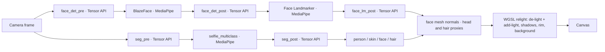

# Meet-Relight

**Studio lighting for your video calls: real-time, private, in the browser, powered by LiteRT.js and the Tensor API.**

Meet-Relight relights a live webcam feed with a virtual 3-point light rig (key / fill / rim). It finds your face and hair, rebuilds their 3D shape, removes the light already in your room and adds the lights you choose. It all runs on the GPU, every frame, in a browser tab. An on-device **Gemma 4** model can set up the lighting from a sentence ("Wong Kar-wai neon", "less shadow"), your voice, or a reference photo.

Nothing leaves your machine: no server, no uploads.

## Highlights

- **MediaPipe models on LiteRT.js (WebGPU):** Selfie Multiclass segmentation, the BlazeFace face detector and the 478-point Face Landmarker.
- **Tensor API pre/post-processing:** resize, normalise, anchor decode and landmark un-projection are written in C++ with the [LiteRT Tensor API](https://github.com/google-ai-edge/LiteRT) and exported as five tiny `.tflite` graphs (< 70 KB total). They are chained GPU buffer to GPU buffer with the models, with **no CPU readback** from camera to mask and landmarks.
- **Greenroom de-lighting:** a ~1.5 s capture fits the room's lighting (9-coefficient spherical harmonics). Relighting can then *remove* harsh shadows as well as add light. The same capture auto-fits the face-mesh boundary to your hairline.
- **Quotient relighting:** `new = camera × target_light / room_light`, looked up per surface normal. Skin texture and colour are preserved exactly.
- **Same-frame mode:** perception runs on the frame being displayed (about 8 ms extra latency), so the light never trails your face.
- **Virtual backgrounds** with matching curated or auto-estimated lighting, guided-filter hair matting and hair relighting.
- **Gemma 4 lighting assistant (E2B / E4B)** in a Web Worker, using text, voice or a reference image → tool calls that drive the rig.

## Quick start

Requirements: Node ≥ 20, [pnpm](https://pnpm.io), and Chrome (or another browser with WebGPU).

```bash
pnpm install
pnpm assets        # copies LiteRT.js / MediaPipe wasm and downloads the MediaPipe models
pnpm dev           # → http://localhost:5173/live.html
```

Build a static site, which you can host from any sub-path:

```bash
pnpm build         # → apps/demo/dist
```

The Gemma 4 model (2.2 GB for E2B) downloads on first use. It is then cached by the browser.

## How it works



| Tensor API graph | What it does |
|---|---|
| `seg_pre` | camera RGBA → 256² → [-1, 1] |
| `seg_post` | softmax over 6 classes + one FullyConnected → 4 mask channels (person, skin, face, hair) |
| `face_det_pre` | letterbox → 128² → [-1, 1] |
| `face_det_post` | BlazeFace decode: ArgMax best anchor, Gather, box and keypoint decode, score |
| `face_lm_post` | 478 landmarks from the rotated crop back to frame coordinates (in-graph rotation matrix) |

Source: [`native/tensor_graphs/meet_relight_graphs.cc`](native/tensor_graphs/meet_relight_graphs.cc). The generated graphs are committed in `apps/demo/public/models/`. To rebuild them you need Bazel; `pnpm graphs` clones LiteRT and runs the generator.

## Repository layout

| Path | Contents |
|---|---|
| `apps/demo` | The web app (Vite). `live.html` is the main demo; the other pages are developer tools |
| `packages/live-perception` | LiteRT.js seg/face runners, face-mesh geometry, Greenroom SH fit, matte refinement, shadows |
| `packages/relight-shader` | WGSL relighting renderer, quotient MatCap bake, lighting model, SH math |
| `packages/shared-schema` | Lighting-rig / target-profile types and JSON schema |
| `packages/gpu-core` | WebGPU device helpers |
| `native/tensor_graphs` | C++ Tensor API graph generator + a `.tflite` static-batch tool |
| `scripts` | Headless-Chrome smoke / capture / Gemma end-to-end scripts (dev only) |
| `docs` | Design doc (Chinese) and presentation highlights |

## Development

```bash
pnpm test          # unit tests (vitest)
pnpm typecheck
```

The headless scripts in `scripts/` use system Chrome with a fake camera:

```bash
node scripts/smoke.mjs http://localhost:5173/live.html out.png 8000   # FAKE_VIDEO=clip.y4m for a test clip
```

## Limitations

- This is ML perception plus physically-motivated shading, not a neural relighting model. Extreme light directions are limited by the face-mesh geometry.
- Requires WebGPU. Tested in Chrome on Apple Silicon.
- Gemma 4 shares the GPU with the video pipeline, so expect a short hitch on the first answer.

## License and credits

Apache License 2.0; see [LICENSE](LICENSE). Third-party models and runtimes are listed in [NOTICE](NOTICE).
